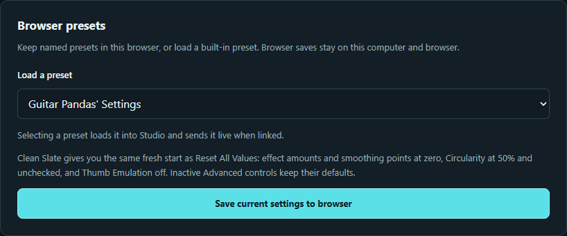

# Analog Keyboard Humanizer

### Make analog keyboard movement feel more like a thumbstick.

Analog keys give you control over how far you move. Getting four separate
fingers to move together as smoothly as one thumb is the tricky part.

Humanizer sits between your analog keyboard and PC, letting you soften presses
and releases, shape turns, and explore more fluid movement inside the stick's
outer edge. You choose how much help you want, and you can watch the difference
as you tune.

It works with the keyboard's existing **XInput left-stick output**. Your analog
key depth still matters. Buttons, triggers, and the right stick pass through
unchanged.

Set up your preferred button layout and analog output curve in your keyboard's
own software, then save that setup to the keyboard before using Humanizer.

**[Download Humanizer v1.0.2](https://github.com/Rambosstic/Analog-Keyboard-Humanizer-/releases/download/v1.0.2/Humanizer-Studio-v1.0.2-Waveshare-RP2350-USB-A.zip)**

For Waveshare RP2350-USB-A. Includes firmware, Humanizer Studio, and the PDF guide.

## What you'll need

- An **analog keyboard with XInput gamepad mode**, capable of saving its
  left-stick mapping onboard. DirectInput and ordinary digital keyboard mode
  aren't supported.
- A [**Waveshare RP2350-USB-A**](https://www.waveshare.com/rp2350-usb-a.htm).
  Current builds and setup instructions are for this board.
- A Windows PC, a USB data cable, and **Chrome or Edge** for the configurator.

The connection is simple:

**Keyboard → board's USB-A port → board's USB-C port → PC**

## Get started

### 1. Set up your keyboard

In your keyboard's own software, enable **XInput / Xbox controller mode** and
map four analog keys to the left stick. WASD is a familiar starting point:
W = up, A = left, S = down, D = right.

Save that setup to the keyboard. Before using the adapter, check that a light
press moves the stick a little and a deeper press moves it farther. Humanizer
receives that stick movement, so you can use a different key layout if you prefer.

**If your keyboard offers square or circular stick output, choose square.**
That gives Humanizer's Circularity control the most room to shape the outer edge.

### 2. Install the firmware

Download the firmware package linked above and extract the ZIP. Keep its
`.uf2` firmware and `Analog Gamepad Helper.html` together—use the configurator
that came with the firmware you're installing.

[All Releases / Previous Versions](https://github.com/Rambosstic/Analog-Keyboard-Humanizer-/releases)

1. Connect the board's USB-C port to your PC using a data-capable cable.
2. Enter its bootloader:
   Hold **BOOT**, tap and release **RESET**, then release BOOT.
   You can also hold BOOT while connecting USB-C.
3. A removable drive appears. Copy the included **`.uf2` firmware file** onto it.
4. The drive disappears as the board restarts. That's expected.
5. Plug your configured keyboard into the board's USB-A host port.

The HTML configurator stays on your PC; it doesn't go onto the bootloader drive.
Keep a copy of your previous working firmware when updating.

Board instructions: [Waveshare RP2350-USB-A](https://www.waveshare.com/wiki/RP2350-USB-A).

### Optional Waveshare enclosure

Want to print a case for your **Waveshare RP2350-USB-A**?
[Download the enclosure STL files](https://github.com/Rambosstic/Analog-Keyboard-Humanizer-/releases/download/enclosure-v2/Waveshare-Humanizer-Enclosure-v2.zip).
The ZIP contains **Top_v2.stl** (top shell with the logo and B/R markings) and
**Bottom_v2.stl** (bottom shell). This optional download is separate from the
firmware package; you don't need a printed case to use Humanizer.

### 3. Open Humanizer Studio

Open **`Analog Gamepad Helper.html`** in Chrome or Edge. Studio runs from that
local file; there's no account to create.

Click **Link To Hardware**. If prompted, select **Humanizer Studio** and click
**Connect**.

An adapter with no saved configuration starts with **Clean Slate**.

### 4. Find your feel

On your first visit, Studio starts with **Clean Slate**, so there's no need to
reset anything before experimenting. When you come back, it restores your last
browser setup until you link; linking automatically loads the adapter's settings.

Settings take effect while you're linked, so you can adjust a slider and try
the movement immediately. A useful first experiment is:

1. Choose **Exponential**, then try **10% Response** and **10% Return**.
2. Try quick presses, gradual releases, and rolling between neighboring keys.
3. Compare **Phase-Aware** at the same values, then adjust to taste.

Those values are just a starting point. More smoothing makes movement more
gradual and takes longer to follow your changes.

For a ready-made setup, open **Profiles → Browser Presets → Load A Preset**.
Under **Built-in presets**, choose **Suggested Starting Point** or
**Guitar Pandas' Settings**, the author's personal setup. Both are included in
Studio; you don't need to download a config file. Selecting one loads it.

**Suggested Starting Point** uses these settings:

| Setting | Value |
| --- | --- |
| Circularity | On, 3% |
| Response | Exponential, Global 10% |
| Return | 10% |
| Maximum Angular Offset | 2° |
| Outward Arc / Return Arc | Up to 2° each |
| Wander Amount / Speed | 10% each |
| Thumb Emulation | On, Simple, Strength 5% |

Both presets are optional starting points. Try either one, then adjust to taste.

### Start fresh whenever you like

**Reset All Values** clears your current tuning to a clean starting point:
smoothing, arc, offset, and wander amounts are zero, Thumb Emulation is off,
and Circularity is at 50% with **Apply Circularity unchecked**. All deflection
smoothing points are zero too. Inactive Advanced controls keep their normal
defaults, ready for when you choose to use them.

You can load that same starting point from **Profiles → Clean Slate**. It's
built into Studio and always available, even if you haven't saved any profiles.

## A quick tour of the tuning pages

| Page | What to explore |
| --- | --- |
| **Response** | How smoothly the stick follows your presses and direction changes. Choose Exponential or Phase-Aware. |
| **Return** | How smoothly it moves inward as you ease off the keys, including during a roll. It follows your selected Response model, with its own amount. |
| **Circularity** | The shape of the outer edge. Turn **Apply Circularity** on to use it; lower values make the boundary rounder. |
| **Angular Offset** | A little variation in the direction a movement starts. |
| **Arc** | A varying bend while moving outward or returning inward. |
| **Wander** | Small changes in direction while holding steady, with separate amount and speed controls. |
| **Thumb Emulation** | Extra help connecting turns and controlling their radius. It starts off; enable it and raise Strength to try it. |
| **All Tunings** | Every tuning section together, with Live Preview still available. |

Each control has its own explanation in Studio, so you don't need to memorize
the settings before trying them.

**Want finer control?** Response's deflection-based smoothing lets you use
different amounts for light, medium, and full stick movement. Its advanced curve
has ten standard points and room for ten custom points you can add and drag.
When using either deflection-based mode, the Global smoothing slider is disabled.

**Thumb Emulation** has a Simple preset and six Advanced controls. Simple always
uses its preset; Advanced brings back your custom values. Strong settings can
make changes in direction or circle size take noticeably longer, so try small
adjustments first. **Reset Thumb Emulation** resets just that section.

## See what your settings are doing

**Live Preview** shows the keyboard's incoming stick movement and Humanizer's
processed output. View them together, side by side, or show processed movement
alone. Expand the preview or pop it into its own window when you want more space.

In **Preview appearance**, choose colors, lines, dashes or dots, thickness,
opacity, and trail fade. These change the view, not your movement settings.

Under **Diagnostics**, the **Press & release timing** test puts numbers to the
feel: press and hold one direction, then release when prompted. It shows how
much extra time your settings take to reach full movement and return to center.
The graphs compare raw and processed movement, with the added delay labeled
between their markers.

That is **movement settling time inside Humanizer**, not total keyboard-to-screen
latency. “Raw” here means the stick output your keyboard reports before
Humanizer processes it.

## Keep a setup you like

- **Save To Device** stores your entire current configuration in the Waveshare's
  onboard memory, including any changes you've made. Once saved, you can close
  Studio. The Waveshare keeps using those settings, including after unplugging
  and reconnecting; the configurator does not need to stay open.
- **Exit Without Saving** returns to the last saved device settings.
- **Browser presets** in Profiles are handy for keeping named setups in the
  same browser on the same computer. Clearing browser data can remove them,
  and they may not follow you to another browser or copy of Studio.
- **JSON config files** are your portable backups. Under **Profiles → Config
  files**, choose **Save config** to pick a filename and location. Keep a JSON
  copy of any setup you want to keep, even if you also save it in your browser.
  You can back it up alongside your other files, move it to another computer,
  or share it with friends and other users. Choose **Load config** to open one.

**Keep a JSON backup of every setup you want to keep.** Browser presets are
convenient, but clearing browsing data can erase your saved presets. A JSON
file kept in a safe folder lets you restore your setup or share it with others.

Loading a preset or JSON config does not save it to the Waveshare. Choose
**Save To Device** when you're happy with the current configuration.

**To change your setup later:** reopen Studio, click **Link To Hardware** if
it hasn't already linked, make your changes, then click **Save To Device**
again. You can close Studio once the settings are saved.

## Need a hand?

If nothing moves, check the basics first: **XInput mode**, an onboard left-stick
mapping, keyboard in **USB-A**, and a data-capable **USB-C** connection to the PC.
Some keyboards take a few seconds to initialize; Turtle Beach can take longer
than Wooting.

If Studio won't link, try Chrome or Edge and make sure the HTML and firmware
came from the same release package. If the port chooser is empty, check the
USB data cable and that the board is running the current firmware. Close other
applications or Studio tabs using its serial port before trying again.

Found a bug? Open **Diagnostics → Report A Bug** to visit our public
[GitHub Issues page](https://github.com/Rambosstic/Analog-Keyboard-Humanizer-/issues).
Choose **New issue**, describe what happened and what you expected, and include
your keyboard, build version, and settings if known.

**A recording is optional.** For movement problems, **Diagnostics → Record
stick movement** can save a diagnostic JSON file. Drag that saved file into
your issue's description or use GitHub's attachment button. You can report a
problem without a recording; Studio doesn't upload anything automatically.

Have feedback or a feature idea? Open **Diagnostics → Share Feedback / Suggest A Feature**
to post or join a conversation in [GitHub Discussions → Ideas](https://github.com/Rambosstic/Analog-Keyboard-Humanizer-/discussions/categories/ideas).
